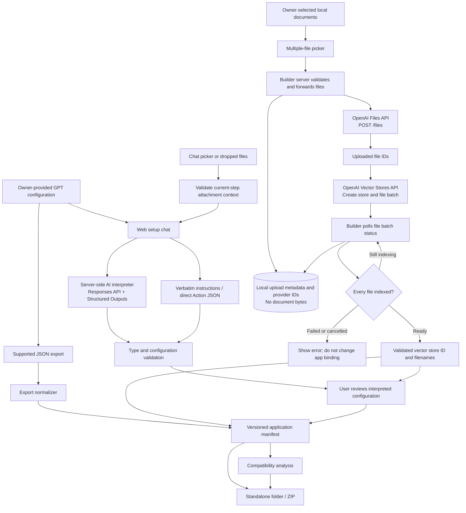
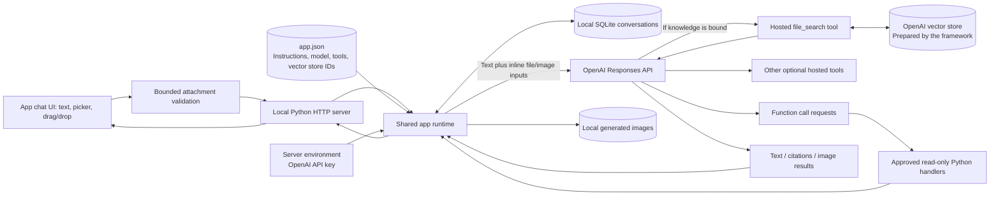

# GPT Application Framework

Convert Custom GPT configurations you own into standalone Python chat applications powered by the OpenAI API.

Create an application through AI-assisted setup, or import an owner-provided JSON export. Review compatibility, try the app locally, and download a self-contained application folder or ZIP.

Explore the [AI App Studio companion page](https://ai-app-studio-introduction.peppyshrimp1.chatgpt.site) for the walkthrough and architecture, or read the [illustrated introduction](docs/launch/illustrated-introduction.md).

**Status:** local, single-user prototype. The framework provides configuration migration and a shared runtime. It does not guarantee identical behavior to the original GPT or provide production hosting.

- **Python:** 3.11+; the Docker image includes Python 3.13.
- **Runtime dependencies:** Python standard library only; browser Markdown/sanitizer libraries are bundled locally.
- **License:** [MIT](LICENSE).

## Contents

- [What it does](#what-it-does)
- [Quick start](#quick-start)
- [Run with Docker](#run-with-docker)
- [Configuration](#configuration)
- [Ways to use the framework](#ways-to-use-the-framework)
- [Run a generated application](#run-a-generated-application)
- [Architecture](#architecture)
- [OpenAI APIs and tools](#openai-apis-and-tools)
- [Application format](#application-format)
- [Knowledge files and Actions](#knowledge-files-and-actions)
- [Extensions](#extensions)
- [Local HTTP interface](#local-http-interface)
- [Privacy and public repositories](#privacy-and-public-repositories)
- [Limitations](#limitations)
- [Testing](#testing)
- [Troubleshooting](#troubleshooting)
- [Project layout](#project-layout)
- [Contributing](#contributing)
- [License](#license)

## What it does

| Feature | Behavior |
| --- | --- |
| AI-assisted setup | Interprets natural-language replies, validates settings, and asks about ambiguous answers |
| JSON import | Normalizes a supported owner-provided export into a versioned application manifest |
| Compatibility checks | Separates blocking dependencies from suggestions for behavior review |
| Standalone builds | Packages one app with its backend, web UI, configuration, and compatibility report |
| Chat | Streams live responses and renders Markdown, with local conversations, citations, generated images, and selected hosted tools |
| Knowledge files | Uploads multiple selected documents to OpenAI, indexes a vector store, and binds a fully ready collection to an app |
| Backend extensions | Calls explicitly registered, read-only Python functions |
| Local and Docker launchers | Starts the builder, waits for readiness, and opens the correct browser URL |

The original GPT is unchanged. A public GPT URL or name cannot provide its private instructions, files, or Action definitions.

## Quick start

### 1. Get the source

Clone the public repository and open its folder:

```sh
git clone https://github.com/skarlekar/ai-app-studio.git
cd ai-app-studio
```

You can also download and extract the repository ZIP from GitHub, then open a terminal in the extracted folder.

### 2. Start the framework

On macOS, Linux, or a Bash-capable environment with Python 3.11+:

```sh
./start.sh
```

The launcher:

1. Finds a supported Python interpreter.
2. Uses your existing `OPENAI_API_KEY` and `OPENAI_MODEL`, or prompts for them in the terminal.
3. Hides the key while you type and keeps it only in the process environment for this run.
4. Creates local app and history directories if needed.
5. Starts the framework and opens [http://127.0.0.1:8765](http://127.0.0.1:8765) after the server is ready.

Leave the terminal open. Press **Ctrl+C** to stop the server. `./run.sh` is an alias for the same launcher. If executable permissions were lost during download, run `bash start.sh` instead.

AI-assisted setup and app conversations require an OpenAI API key and an API model available to your project. The setup model must support the Responses API and Structured Outputs. The app model must support its selected tools. API usage is billed to your API project; ChatGPT subscription access does not configure this server's API access.

### 3. Create an application

Choose **Create application** and provide:

1. Name and description.
2. Full GPT instructions.
3. Conversation starters.
4. Enabled capabilities: web search, image generation, and/or code interpreter.
5. App model ID, or the server default.
6. Knowledge filenames, if any.
7. Action definitions, if any.
8. A final review and instruction to create the app.

You can answer naturally:

| Step | Example reply | Result |
| --- | --- | --- |
| Name | “Call it Spanish Teacher” | Extracts the application name |
| Starters | “No conversation starters needed” | Empty starter list |
| Tools | “Enable web search but no images or code” | Web search only |
| Model | “Use the default model” | Uses the server's app model |
| Knowledge | “I don't have any knowledge files” | Empty inventory; no vector store needed |
| Actions | “No actions are required” | Empty Action list |
| Ambiguous reply | “I'm not sure about files” | Asks a follow-up without advancing |
| Final review | “Looks good, go ahead” | Saves the reviewed application |

The AI interprets one guided step at a time. GPT instructions remain verbatim, and actual Action JSON schemas are parsed directly rather than rewritten by the model. Other interpreted values pass through server validation before being accepted. Review the summary, especially enabled tools, filenames, and model selection.

Use `back` to revise the previous step and `cancel` to leave setup. Shift+Enter inserts a newline. Drafts live in the browser until creation; reloading discards an unfinished draft. AI/API failures keep the current step and draft so you can retry.

The guided setup also provides Back and Cancel setup buttons near the composer. Navigation is disabled while an answer is being interpreted. Create application is the main action in the builder; New conversation is the main action in generated apps. On smaller screens, the Conversations button opens saved history.

### Launcher options

```sh
./start.sh --port 9000
./start.sh --apps migrated/apps
./start.sh --apps apps --data .gptapps-data --no-browser
./start.sh --help
```

The default catalog is `apps/`. Use `--apps migrated/apps` to open configurations created by earlier versions of the framework. Relative directory options are resolved from the framework root, even if you launch the script from another directory. An occupied port produces an error; the launcher does not stop another process.

## Run with Docker

Docker runs the Python backend in a container, so you do not need Python installed on the host. Install and start Docker Desktop, or use a working Docker Engine installation with Bash.

```sh
./docker-start.sh
```

The Docker launcher prompts for missing settings, builds the image, starts the builder, waits for the container's health check, and opens the browser. Press **Ctrl+C** in the launcher terminal to stop and remove its container.

```sh
./docker-start.sh --port 9000
./docker-start.sh --apps migrated/apps --no-browser
./docker-start.sh --help
```

| Component | Location |
| --- | --- |
| Python runtime | Official `python:3.13-slim` base image; build verifies Python 3.11+ |
| Application source | `/app/gptapps` inside the container |
| Application manifests | Host `apps/` mounted at `/data/apps` |
| Conversations and generated images | Host `.gptapps-data/` mounted at `/data/runtime` |
| API credentials | Passed from the launcher's environment; excluded from image builds |
| Browser access | Host `127.0.0.1:PORT`, published to the same container port |

App configurations and history survive container removal because they are bind-mounted from the host. The launcher runs the container with your host user/group IDs to keep these files usable outside Docker. The image itself defaults to a non-root numeric user. `GPTAPPS_DOCKER_IMAGE` and `GPTAPPS_CONTAINER_NAME` can override the default image tag and container name.

The backend binds to `0.0.0.0` **inside** the container so port publishing can reach it. The launcher publishes only to `127.0.0.1` on the host, following Docker's [localhost publishing syntax](https://docs.docker.com/engine/network/port-publishing/). The browser's port and the backend port must match because Host/Origin validation uses that port.

To build and run manually, first export `OPENAI_API_KEY` and `OPENAI_MODEL` in your shell, then:

```sh
mkdir -p apps .gptapps-data
docker build -t gpt-app-framework:local .
docker run --rm --init \
  --user "$(id -u):$(id -g)" \
  -p 127.0.0.1:8765:8765 \
  -e OPENAI_API_KEY -e OPENAI_MODEL -e OPENAI_SETUP_MODEL \
  -v "$PWD/apps:/data/apps" \
  -v "$PWD/.gptapps-data:/data/runtime" \
  gpt-app-framework:local
```

The Docker build copies only the runtime source, public example, entrypoint, and license. `.dockerignore` excludes local credentials, private GPT exports, and application history from the build context. No model or key is baked into the image.

## Configuration

| Environment variable | Purpose | Default |
| --- | --- | --- |
| `OPENAI_API_KEY` | Server-side OpenAI project key | Required for live AI requests |
| `OPENAI_MODEL` | Default model for converted apps; fallback model for setup | No hardcoded model |
| `OPENAI_SETUP_MODEL` | Separate model for interpreting setup replies; must support Structured Outputs | `OPENAI_MODEL` |
| `GPTAPPS_PORT` | Port used by either launcher | `8765` |
| `GPTAPPS_APPS_DIR` | Launcher app catalog directory | `apps/` under the framework root |
| `GPTAPPS_DATA_DIR` | Launcher conversation/asset directory | `.gptapps-data/` under the framework root |
| `GPTAPPS_PYTHON` | Local launcher's Python executable name or full path | Supported `python3`, then `python` |
| `GPTAPPS_DOCKER_IMAGE` | Docker image tag | `gpt-app-framework:local` |
| `GPTAPPS_CONTAINER_NAME` | Docker container name | `gpt-app-framework-PORT` |

### Model examples

`OPENAI_MODEL` powers conversations in converted apps. `OPENAI_SETUP_MODEL` interprets the framework's setup replies, so it can usually be a smaller, less expensive model. These are starting points to evaluate with your own GPTs:

| Use case | `OPENAI_MODEL` | `OPENAI_SETUP_MODEL` |
| --- | --- | --- |
| Balanced app capability with economical setup | `gpt-6.1-sol` | `gpt-6-luna` |
| Simple chat apps and lower-cost experimentation | `gpt-6-luna` | `gpt-6-luna` |
| More demanding reasoning in the converted app | `gpt-6-astra` | `gpt-6-luna` |
| More capable interpretation of complicated setup replies | `gpt-6.1-sol` | `gpt-6.1-sol` |

OpenAI documents Responses API and Structured Outputs support for [GPT-6 Luna](https://developers.openai.com/api/docs/models/gpt-6-luna), [GPT-6.1 Sol](https://developers.openai.com/api/docs/models/gpt-6.1-sol), and [GPT-6 Astra](https://developers.openai.com/api/docs/models/gpt-6-astra). Their model pages also list supported hosted tools. Check your API project's access and the particular tool combination you enable; these examples do not guarantee availability or behavior parity.

For a balanced starting configuration:

```sh
export OPENAI_MODEL="gpt-6.1-sol"
export OPENAI_SETUP_MODEL="gpt-6-luna"
./start.sh
```

The launcher will prompt securely for the API key if it is missing. The same settings work with Docker:

```sh
export OPENAI_MODEL="gpt-6.1-sol"
export OPENAI_SETUP_MODEL="gpt-6-luna"
./docker-start.sh
```

To use one model for both roles, set `OPENAI_MODEL` and leave `OPENAI_SETUP_MODEL` unset. During conversion, answer “use the default model” to inherit `OPENAI_MODEL`, or supply an exact model ID such as `gpt-6.1-sol` for that app alone. Use API model IDs rather than display names from ChatGPT. Image-only, audio-only, and embedding models are not setup interpreter models.

A converted app can set `runtime.model` in its manifest to override `OPENAI_MODEL`. This does not change the framework's setup interpreter model. The CLI's `--apps`, `--data`, `--port`, and `--host` settings are command-line options; the `GPTAPPS_*` launcher defaults are not automatically read by the CLI.

[.env.example](.env.example) documents the settings. **The Python server and launchers do not automatically load `.env` files.** Use the launcher prompts or your normal environment/secret management. Never enter keys in GPT instructions, Action schemas, the web builder, or source control.

Importing JSON, analyzing manifests, and building application folders work without API credentials. Plain `serve` can also start without them, but live setup interpretation and app chat will fail until the required server environment is configured.

## Ways to use the framework

### AI-assisted conversion

Run `./start.sh`, choose **Create application**, answer the questions, and review the result. At the knowledge step, select multiple files, choose **Upload and index**, wait until all files are ready, and choose **Use these files**. The builder offers downloads for the full configuration and a standalone ZIP with the vector store binding included. Action definitions still need reviewed backend adapters.

### Import a JSON export

Try the included non-private example first:

```sh
python3 -m gptapps import examples/minimal-export.json --out migrated
python3 -m gptapps serve --apps migrated/apps --builder
```

For your own export, replace the input path with a file you own or are authorized to migrate. The destination must be new to avoid accidental overwrite. Output contains:

```text
migrated/
├── apps/
│   └── APP_ID.json
└── report.json
```

The supported format has a top-level `gpts` array. See [examples/minimal-export.json](examples/minimal-export.json) for a complete input. Each entry uses:

- Unique string `id`, nonempty `name`, and full `instructions`.
- Optional `description` and `conversation_starters`.
- Explicit `capabilities.items` entries with string `key` and boolean `enabled`.
- `knowledge.files` as filenames or file records with `name`/`filename`.
- `actions.count` and/or `actions.items` to record Action requirements.

Known capability keys are `web_search`, `image_generation`, and `code_interpreter_and_data_analysis`. Unknown enabled capabilities become blockers. Other export formats need an explicit adapter that produces the same application contract.

Bulk import copies file names and Action counts/IDs. It deliberately does not copy opaque Action authentication objects or schemas. Add reviewed, credential-free schemas through conversational setup or a source adapter.

### Check compatibility

```sh
python3 -m gptapps check migrated/apps/APP_ID.json
```

Replace `APP_ID` with an actual filename from the import. A check exits with code **2** for deterministic blockers; invalid input or filesystem errors exit with code **1**. Review suggestions do not block basic chat.

`runtime_ready: true` means known configuration dependencies are bound. It does not establish model access, API availability, behavioral parity, or production readiness.

### Build a standalone app

```sh
python3 -m gptapps build migrated/apps/APP_ID.json --out dist/my-app
```

Replace `APP_ID` with the actual manifest filename. For a chat-created app, use its path under `apps/` instead. The output directory must be new. Then follow [Run a generated application](#run-a-generated-application). The same launchers are included in ZIP downloads from the builder.

### Use the plugin scaffold

[plugin/](plugin/) contains an optional migration skill and plugin manifest for a compatible host. It orchestrates collection, import, review, and generation using this framework. It is not installed or published by the repository and does not provide a hosted MCP server or private ChatGPT API scraper. Browser-assisted collection depends on the host's separate browser tools and signed-in session.

## Run a generated application

Each generated folder or ZIP includes its own source code, README, Python launcher, and Docker launcher. You can move the entire folder to another computer; it does not need this framework checkout or access to the GPT in ChatGPT. The generated launchers start the **end-user app**, with builder controls and setup interpretation disabled.

### 1. Get the complete application folder

**From the browser:** select your app and click **Download standalone app**. Extract the complete ZIP into a new folder. For example, replace `APP_ID-app.zip` below with your actual download filename:

```sh
python3 -m zipfile -e "$HOME/Downloads/APP_ID-app.zip" "$HOME/my-gpt-app"
cd "$HOME/my-gpt-app"
```

You can also use your operating system's ZIP extraction tool; this is useful if you will use Docker and do not have host Python installed. A configuration-only JSON download is not a complete application bundle.

**From a CLI build:** open the output folder you chose:

```sh
cd dist/my-app
```

Make sure this folder contains `app.json` and the launch scripts:

```text
my-app/
├── app.json
├── compatibility.json
├── LICENSE
├── gptapps/             # Copied backend and web UI
├── run.py
├── start.sh             # Local Python launcher
├── docker-start.sh      # Docker launcher; no host Python needed
├── Dockerfile
├── scripts/             # Launcher helpers and container entrypoint
├── README.md
├── .gitignore
└── .dockerignore
```

### 2. Choose how to start it

**With local Python 3.11+:**

```sh
./start.sh
```

**With Docker Desktop or Docker Engine running:**

```sh
./docker-start.sh
```

The generated Dockerfile includes Python 3.13, so Docker users do not need host Python. If executable permissions were lost while extracting the ZIP, use `bash start.sh` or `bash docker-start.sh`.

Both scripts prompt for a missing OpenAI API key in the terminal with hidden input. If neither the manifest nor your environment specifies an app model, they also ask for an API model ID, such as `gpt-6.1-sol`. They wait for readiness and open [http://127.0.0.1:8765](http://127.0.0.1:8765). Keep the terminal open and press **Ctrl+C** to stop the app or container.

To select the environment default model before launching:

```sh
export OPENAI_MODEL="gpt-6.1-sol"
./start.sh
# Or: ./docker-start.sh
```

The scripts reuse an already exported `OPENAI_API_KEY`. They keep a key entered at the prompt only for the current run. `runtime.model` in `app.json` takes precedence over `OPENAI_MODEL`; set it to `null` if you want the environment default to apply. Generated apps do not need `OPENAI_SETUP_MODEL`. Choose a model your API project can access and that supports the app's selected tools. No `.env` file is loaded automatically.

### 3. Use a different port or data folder

If the framework is still running on port 8765, start the generated app on another port:

```sh
./start.sh --port 9000
# Or: ./docker-start.sh --port 9000
```

The launcher opens [http://127.0.0.1:9000](http://127.0.0.1:9000) in this example. Other options work with either generated launcher:

```sh
./start.sh --port 9000 --data ./my-chat-history --no-browser
./docker-start.sh --port 9000 --data ./my-chat-history --no-browser
./start.sh --help
```

Relative data paths resolve from the generated app folder. By default, conversations and images are stored in that folder's `.gptapps-data/`. Docker mounts the host data folder so it survives container restarts; it mounts `app.json` read-only at runtime instead of copying private instructions into the image.

### Manual Python and Windows examples

If your key and app model are already configured in the terminal environment, run these commands from the generated folder:

```sh
python3 -m gptapps check app.json
python3 run.py
```

Open [http://127.0.0.1:8765](http://127.0.0.1:8765) manually. A custom-port alternative is:

```sh
python3 -m gptapps serve --apps app.json --data .gptapps-data --port 9000
```

On Windows PowerShell, extract the ZIP and use Python 3.11+ directly. Replace the ZIP filename as needed:

```powershell
Expand-Archive -LiteralPath "$HOME\Downloads\APP_ID-app.zip" -DestinationPath "$HOME\my-gpt-app"
Set-Location "$HOME\my-gpt-app"
$apiKey = Read-Host "OpenAI API key" -AsSecureString
$env:OPENAI_API_KEY = [System.Net.NetworkCredential]::new("", $apiKey).Password
$env:OPENAI_MODEL = "gpt-6.1-sol"
py -3 -m gptapps check app.json
py -3 run.py
```

Then open [http://127.0.0.1:8765](http://127.0.0.1:8765). The Python entrypoint needs no Bash or third-party Python packages. The `.sh` launchers require a Bash-capable environment.

### Compatibility, stopping, and sharing

Review `compatibility.json` or run the check command before relying on an app. Builds can contain unresolved requirements: real knowledge files need vector store bindings, and real Actions need backend adapters. Empty knowledge/Action lists are valid. A successful check does not certify live model access.

Press Ctrl+C before closing the launcher terminal. Keep `.gptapps-data/` to preserve conversations; stop the app and delete that directory only when you want to clear its local history and images. After changing `app.json` or the effective model, restart the server and start a new conversation.

Generated apps contain your private GPT instructions. Their `.gitignore` excludes `app.json` and `compatibility.json` as well as keys and runtime data; deliberately review any configuration you choose to publish. Their configuration and content are not automatically made public or relicensed by building them. The included MIT license covers the copied framework source.

Rebuild or re-download apps created before these launchers were added to receive the new scripts and bundled instructions.

## Architecture

### Framework: migration, knowledge ingestion, and build



The AI interpreter has no file-system, Action, or execution tools; explicitly attached documents are available as input content. It returns a proposed value for the current step or a clarification/navigation intent. The separate uploader forwards explicitly selected files using the server's API key, creates a vector store and batch, and checks indexing status. **Use these files** attaches only a ready collection to the reviewed draft; **Use files for this app** updates an existing app's knowledge binding. An indexing failure leaves an existing binding unchanged.

Server validation runs before accepting settings; the final user instruction triggers app creation. Setup interpretation does not persist its own server conversation. Upload metadata persists locally for recovery, while document contents and the indexed vector store live in the OpenAI project. The ZIP includes the vector store ID and filenames, with no source documents, per-file upload metadata, upload-state files, or local conversation database. Packaging uses a runtime-file allowlist even if a custom data directory is nested under the source package.

### Generated app: chat and knowledge retrieval



Each saved conversation is bound to its app ID and a configuration/model fingerprint. A changed configuration or model requires a new conversation. Previous user and assistant text, plus saved chat attachments, are replayed to the API with `store: false`. Chat attachment bytes remain in local private SQLite history; session UI responses expose names, MIME types and sizes only.

The generated app is self-contained: it reads the saved manifest and does not need the framework running. When knowledge is bound, its Responses request declares `file_search` with `bindings.vector_store_ids`. OpenAI handles retrieval from the already indexed documents and returns answer text and file citations. Chat attachments go directly in the Responses request without creating hosted Files resources. The generated app does not upload permanent knowledge documents, create vector stores, run the setup interpreter, or call the Agents API. Use an API key with access to the same OpenAI project that owns the store; copying the ZIP to another machine does not copy or transfer the hosted knowledge.

## Attach files to chat

In both the public framework and every newly generated app, click **Attach files** next to the message box or **drag files into the chat**. Review the filename/size chips, remove anything you do not want to send, add a question, then click Send. Sending files without typed text is supported. Files stay in your browser until Send; failed requests keep the draft and files ready to retry. Switching conversations/apps or starting a new conversation clears unsent files.

- **Limits:** 5 files per message, 10 MiB per file, 20 MiB combined per message and conversation. Start a new conversation after reaching the cumulative limit. Invalid, empty or unsupported files are rejected before a model call.
- **Formats:** PDF; Word (`.doc`, `.docx`, `.rtf`, `.odt`); PowerPoint; Excel; text, Markdown, JSON, CSV, TSV, XML, HTML and supported source code; PNG, JPEG and WebP images. Archives, audio, video and executable binaries are unsupported. The file picker lists the accepted extensions.
- **Model access:** the configured model must accept the selected input types. PDF/image processing requires a vision-capable model. Non-PDF documents pass extracted text; embedded images/charts are not included. Spreadsheet processing may summarize/sample rows rather than include an entire workbook. See [OpenAI file-input documentation](https://developers.openai.com/api/docs/guides/file-inputs).
- **Data and cost:** the backend sends your typed text and inline `input_file` / `input_image` parts together to `POST /v1/responses`. This path creates no hosted File, vector store, or permanent knowledge binding. Accepted attachments are stored in private local SQLite conversation history for follow-ups and resent on each turn, increasing context usage and API cost. History is not encrypted at rest. Keep the data folder private. Display/history endpoints expose attachment metadata, never base64 bytes; app exports exclude conversation data.
- **Conversational setup:** attach documents as context for the current setup question. Clarification keeps the selected files queued for your next answer; advancing clears them. For the Instructions step, attach UTF-8 text/Markdown/code so its text can be preserved exactly, alongside any typed instructions. PDF/Word/image instructions must first be exported to text or pasted; the framework does not silently rewrite those instructions with AI. For Actions, attach an actual JSON array of complete definitions. The permanent-knowledge step uses its dedicated file picker/index controls, so chat attachments are disabled there. Review/creation requires an explicit typed confirmation without attachments. Attachments at a setup step do not automatically fill other steps.
- **Permanent knowledge:** use the separate **Knowledge files** upload/index panel when every user of the created app needs a searchable knowledge collection. Attaching a file to chat does not index it or bind it to the generated app.

Both chat paths use the server's existing `OPENAI_API_KEY`: regular chat uses the app's model/default `OPENAI_MODEL`; AI setup uses `OPENAI_SETUP_MODEL` (falling back to `OPENAI_MODEL`). No additional API credentials are needed. Existing downloaded apps need a **fresh standalone export** to receive the new UI and runtime.

Version **0.1.1** adds this feature to the public framework. The footer shows its version and build number. Source runs use a stable numeric source fingerprint; each standalone build receives a new immutable build number. Restarting an exported build retains its number. Release versions are maintained in `gptapps/version.py`.

## OpenAI APIs and tools

Chat and setup inference use **`POST https://api.openai.com/v1/responses`**. The framework's knowledge uploader also calls the Files and Vector Stores APIs listed below. All OpenAI calls run on the server; there is no OpenAI credential in browser requests.

| Caller / feature | API or tool | When used |
| --- | --- | --- |
| Framework: setup interpretation | Responses API with `text.format.type: json_schema`, `strict: true` | Natural-language setup replies and review/navigation intents |
| Framework: knowledge upload | Files API `POST /v1/files`, multipart upload with `purpose: assistants` | Once for each selected knowledge document |
| Framework: knowledge collection | Vector Stores API `POST /v1/vector_stores` | Creates a new collection for selected files |
| Framework: knowledge indexing | Vector Stores API `POST /v1/vector_stores/{id}/file_batches` | Indexes the uploaded file IDs together |
| Framework: indexing progress | Vector Stores API `GET /v1/vector_stores/{id}/file_batches/{batch_id}` | Checks completion and failed/cancelled counts before binding |
| Converted app: chat | Responses API, with `stream: true` for the web chat | Each app conversation turn |
| Framework and converted app: chat attachments | Responses inline `input_file` and `input_image` content | Explicitly selected/dropped files sent with a message; no Files/Vector Stores call |
| Converted app: structured output | Responses `text.format` with the configured object JSON Schema | If `runtime.output_schema` is set |
| Converted app: web search | Responses hosted `web_search` tool | If enabled in `runtime.hosted_tools` |
| Converted app: image generation | Responses hosted `image_generation` tool | If enabled; returned images are saved locally |
| Converted app: code execution/data analysis | Responses hosted `code_interpreter` with an automatic container | If enabled |
| Converted app: knowledge retrieval | Responses hosted `file_search` | If existing `bindings.vector_store_ids` are configured |
| Converted app: backend integrations | Responses function calling plus local registered Python handlers | If explicitly bound to reviewed read-only tools |

Responses requests use `store: false`. This controls API response storage; it is not a guarantee about every aspect of provider data handling. Uploaded files and vector stores remain in your API project until removed or expired under OpenAI's policies; `store: false` does not delete them. See OpenAI's documentation and your project's policies.

**Not implemented:** direct Embeddings API calls, separate Images API endpoints, the Agents API/SDK, remote MCP connections, Realtime, transcription, speech synthesis, and moderation integrations. Hosted image generation and file search run through Responses. Original GPT Actions do not automatically become executable integrations. The Files API's `assistants` purpose is a file-use label; this framework does not call the Assistants API.

Adding knowledge files or Actions does not switch the generated app to Agents API.
Knowledge retrieval uses Responses `file_search` after the uploader creates and binds
an indexed vector store, or you supply one manually. Actions use Responses function calling after you register and bind
reviewed backend handlers. An Agents API runtime would require a separate
implementation. It is a general-purpose managed agent runtime, not a conversion
requirement for Custom GPTs or Workspace agents; see OpenAI's
[runtime comparison](https://developers.openai.com/api/docs/guides/agents).

The separate [Workspace Agents API](https://learn.chatgpt.com/workspace-agents/trigger-runs)
triggers published agents that remain in ChatGPT. This framework does not implement
Workspace Agent import, Workspace API triggers, or automatic migration to Agents API.

Official references: [Responses API](https://developers.openai.com/api/reference/resources/responses/methods/create), [Structured Outputs](https://developers.openai.com/api/docs/guides/structured-outputs), [web search](https://developers.openai.com/api/docs/guides/tools-web-search), [image generation](https://developers.openai.com/api/docs/guides/tools-image-generation), [code interpreter](https://developers.openai.com/api/docs/guides/tools-code-interpreter), [file search](https://developers.openai.com/api/docs/guides/tools-file-search), and [function calling](https://developers.openai.com/api/docs/guides/function-calling).

### Streaming and rich text

The web chat requests a live stream. The backend reads OpenAI's [Responses streaming events](https://developers.openai.com/api/docs/guides/streaming-responses) and flushes text deltas to the browser as they arrive. Tool activity updates the status while a request is working. Final text, citations, image attachments, and usage come from the terminal provider response. Completed turns are saved; usable text explicitly stopped by the output-token limit is saved with a partial-answer marker.

Assistant messages render Markdown headings, bold/italic text, lists, blockquotes, links, tables, and fenced/inline code. The same renderer is used during streaming and when reopening a saved conversation. User messages and setup instructions remain literal text. [Marked and DOMPurify](gptapps/vendor/README.md) are bundled with the source, generated apps, and Docker images; the UI does not depend on a CDN. Rendered markup is sanitized, external Markdown images are excluded, and scripts, event handlers, unsafe link schemes, and interactive forms are not allowed.

If OpenAI reports `incomplete_details.reason: max_output_tokens` with usable text, the answer remains visible and is saved with `message.incomplete_reason: max_output_tokens`. A notice identifies it as partial and offers **Continue response**. Clicking Continue sends one new follow-up in the same conversation; the app does not automatically retry, raise budgets, or continue in a loop. Saved conversations retain the notice. Incomplete structured JSON, function calls, reasoning-only responses, content-filter stops, and other failures are not accepted as usable text answers.

If a stream fails or ends without a terminal provider response, partial text is not saved. The UI restores the submitted input and displays the error. If a network interruption prevents confirmation, inspect saved conversations before resending. Previously generated apps need to be rebuilt or re-downloaded to include these changes; restart the server and refresh the browser after updating.

### Long responses and output limits

New app configurations default to **16,384 output tokens** per model call. This budget includes visible text and reasoning, so it is not a word count. You can edit `runtime.max_output_tokens` in the app manifest; the framework accepts budgets up to 131,072, but your selected model must support the value and sufficient context must remain. Higher limits permit greater API usage; actual usage is billed by OpenAI. See [OpenAI's reasoning and output-limit guidance](https://developers.openai.com/api/docs/guides/reasoning).

Existing configurations keep their explicit budget. Older manifests commonly use 2,048; downloading them again does not silently change that setting. For an existing app:

1. Rebuild or re-download it from the updated framework to receive the new runtime and interface.
2. Edit its `app.json` and change `runtime.max_output_tokens` to `16384` (or another supported budget). To make future downloads use that budget, edit the source manifest in the framework's app catalog as well.
3. Restart the server and start a new conversation after changing configuration.

If OpenAI uses the whole budget before producing visible text, the error now identifies `max_output_tokens`, the configured limit, and the need for reasoning headroom. No empty turn is saved. The older generic incomplete-response error did not retain the cause and cannot establish retrospectively which limit was hit.

## Application format

The canonical manifest uses schema version `1.0`:

| Section | Purpose |
| --- | --- |
| `id`, `name`, `description` | Safe application identity and display metadata |
| `instructions` | Full developer instructions, handled as configuration data |
| `conversation_starters` | Initial prompts shown in the app |
| `source` | Import/setup origin and source identifier |
| `runtime` | Responses API, model, hosted tools, limits, optional output schema |
| `bindings` | Vector store IDs, allowed function names, Action-to-function mappings |
| `requirements` | File inventory, Action IDs, unsupported enabled capabilities |
| `action_definitions` | Credential-free Action definitions for chat-created apps |

Frequently edited settings:

```json
{
  "runtime": {
    "api": "responses",
    "model": null,
    "hosted_tools": [],
    "max_output_tokens": 16384,
    "max_tool_rounds": 4,
    "output_schema": null
  },
  "bindings": {
    "vector_store_ids": [],
    "function_tools": [],
    "action_tools": {}
  },
  "requirements": {
    "knowledge_files": [],
    "actions": [],
    "unsupported_capabilities": []
  }
}
```

This is a manifest fragment; required identity and instruction fields are omitted for readability. Existing manifests can be edited as JSON. Conversational editing of an already-saved app is not implemented. Restart its server and start a new conversation after changing configuration.

## Knowledge files and Actions

### GPTs without external resources

Empty knowledge and Action lists are valid. An app without knowledge files does not need `vector_store_ids`. An app without Actions does not need backend adapters. Natural-language absence replies are interpreted as empty lists; uncertainty triggers a follow-up.

### Knowledge retrieval

The builder can upload and index your documents directly in your OpenAI API project:

1. During **Create application**, reach the knowledge step. For an already saved/imported app, select it and open **Knowledge files** in the sidebar.
2. Choose multiple local documents, then click **Upload and index**. The UI shows selected filenames, upload progress, and indexing status.
3. Wait for **All files are indexed and ready**. Failed or partially indexed collections cannot be attached.
4. Choose **Use these files** during setup, then finish Actions and the final review. For an existing app, choose **Use files for this app**; this replaces its attached knowledge collection and starts a new chat. Previous OpenAI files/stores are retained.
5. Download the standalone app. Its `app.json` contains `bindings.vector_store_ids` and filenames. Use an API key from the same OpenAI project with access to those resources. The original document bytes, per-file provider metadata, and upload-state records are not included in the ZIP.

The browser sends one file at a time through the local framework server to OpenAI. The API key stays on the server, and the framework does not persist uploaded document contents locally. Owner-selected files become retrieval content; they are not interpreted as setup instructions.

**Framework upload limits:** up to 100 files per collection, 25 MiB per file, 100 MiB total; nonempty files with unique filenames. Supported formats are PDF, DOC/DOCX, PPTX, TXT, MD, JSON, and documented code formats (`.c`, `.cpp`, `.cs`, `.css`, `.go`, `.html`, `.java`, `.js`, `.php`, `.py`, `.rb`, `.sh`, `.tex`, `.ts`). Text should use UTF-8, UTF-16, or ASCII. These are this starter's upload limits, not the maximum limits of OpenAI's Files API. OpenAI may reject a file during indexing even if its extension and size are accepted. See [supported file-search formats](https://developers.openai.com/api/docs/guides/tools-file-search).

**Recovery and retention:** upload metadata and provider IDs persist under `.gptapps-data/knowledge-uploads/`. After a browser reload, open the panel and choose a collection under **Previously uploaded collections**. Ready files can be reused without uploading again. For an interrupted browser upload, reselect the same original files to resume; already uploaded bytes are checked locally without repeating the OpenAI upload. In-progress indexing can be checked again. A server interruption during a provider mutation is marked failed rather than retried automatically because its remote outcome may be uncertain.

Uploads and vector stores stay in your OpenAI project if setup is cancelled, indexing fails, a new collection replaces them, or you delete local framework data. OpenAI storage and retrieval charges may apply. The framework does not automatically delete remote resources; review the recorded file/store IDs and manage unused resources in your OpenAI project. It does not retry failed uploads automatically.

CLI/bulk imports still record a file inventory without transferring source files. You can use the builder's **Knowledge files** panel afterward, or set `bindings.vector_store_ids` to an existing indexed collection manually. Re-run `gptapps check` and test retrieval with representative questions.

An inventory with no vector store binding remains a blocker. Clearing real file requirements would change the app's intended behavior; only leave the inventory empty when the GPT has no such files.

### Actions

If there are Actions, paste a JSON array such as:

```json
[
  {
    "name": "Lookup",
    "auth_type": "none",
    "schema": {
      "openapi": "3.1.0",
      "info": {"title": "Lookup", "version": "1.0"},
      "paths": {}
    }
  }
]
```

This is a schema-only example, not a working endpoint. Supported `auth_type` values are `none`, `api_key`, and `oauth`; actual credentials do not belong in this JSON. The builder rejects obvious credential fields and token patterns, but inspect your configuration before sharing it.

The model cannot invent an executable Action from a description. For complete definitions, it asks for the original JSON, which the server preserves directly. Register a trusted backend function and map the recorded Action ID (for example, `action-1`) to that function in `bindings.action_tools`. Unbound Actions block execution. Automatic OpenAPI client generation, OAuth flows, and write operations are not implemented.

## Extensions

`gptapps.extensions.Registry` registers trusted `FunctionTool` implementations. Load only operator-supplied modules:

```sh
python3 -m gptapps serve --apps apps --builder \
  --extension my_extensions:register
```

Then add registered names to `bindings.function_tools` or `bindings.action_tools`. Handlers must validate their own arguments. Imported instructions and Action schemas are never loaded as Python modules.

The included `gptapps.extensions:scoring_example` registers `cosine_score` for supplied vectors. It does not create embeddings, score images, or implement a complete game. Domain rules, hidden state, exact scoring, source verification, and output invariants belong in explicit backend code. Write tools are blocked until an approval/idempotency adapter is implemented.

## Local HTTP interface

These routes are intended for the local UI, not an authenticated public service:

| Route | Purpose | Builder only |
| --- | --- | --- |
| `GET /` | Web chat UI | No |
| `GET /api/config` | UI mode | No |
| `GET /api/apps` | App summaries and compatibility reports | No |
| `POST /api/chat` | App chat turn; `stream: true` returns SSE, omitted/false returns JSON | No |
| `GET /static/chat.js`, `GET /static/vendor/...` | Bundled chat client and Markdown/sanitizer libraries | No |
| `GET /api/sessions?app=ID` | List saved conversations | No |
| `GET /api/sessions?app=ID&id=SESSION_ID` | Load an app's conversation | No |
| `GET /assets/FILENAME` | Generated image | No |
| `POST /api/setup` | Interpret `{field, message, history}` for the current setup step | Yes |
| `POST /api/apps` | Validate and save the reviewed draft | Yes |
| `POST /api/knowledge` | Start a validated collection from `{files: [{name, size}]}` | Yes |
| `POST /api/knowledge/file?id=UPLOAD_ID&index=N` | Forward one selected file as `application/octet-stream` | Yes |
| `POST /api/knowledge/index` | Index uploaded files with `{upload_id}` | Yes |
| `GET /api/knowledge` | List persisted upload collections for recovery/reuse | Yes |
| `GET /api/knowledge/status?id=UPLOAD_ID` | Refresh indexing status and counts | Yes |
| `POST /api/knowledge/bind` | Attach a ready collection with `{app_id, upload_id}` | Yes |
| `GET /api/spec?app=ID` | Download full configuration | Yes |
| `GET /api/build?app=ID` | Download a standalone ZIP | Yes |

JSON POST requests require `Content-Type: application/json`; the single-file upload route requires `application/octet-stream`. App creation can include `knowledge_upload_id` to attach an already indexed collection. Provider IDs supplied by the browser are not trusted as bindings; the server resolves them from its own validated upload record. Host/Origin checks reject unexpected local hosts and cross-origin browser requests. They are not user authentication.

For streaming requests, SSE data objects use `reset` (new model/tool round), `delta` (text plus output/content indices), `status` (tool activity), `done` (saved session and final message), or `error`. The UI waits for `done` to confirm persistence. A `done` message carrying `incomplete_reason: max_output_tokens` is a saved partial answer, not a complete model response; API clients should display that distinction too. Validation errors before streaming starts return JSON with an error HTTP status; errors after streaming starts use an SSE `error` event.

## Privacy and public repositories

This project is a local, single-user starter. The source license does not imply that your exported GPT prompts, knowledge files, Action schemas, history, or generated app configurations are suitable for publication.

The root [.gitignore](.gitignore) excludes local secrets, `apps/`, `migrated/`, `exports/`, `knowledge/`, `.gptapps-data/`, generated archives, `dist/`, virtual environments, caches, and editor files. The public [example](examples/minimal-export.json) and tests contain generic fixture data. [.dockerignore](.dockerignore) restricts the image build context separately. Generated application folders have their own `.gitignore`.

Before your first public commit, inspect what will be staged. Ignore rules do not remove files that were already tracked and cannot detect private content saved under arbitrary names. Never commit `.env`, API keys, private exports, chat databases, or generated app ZIPs. Prefer the documented ignored directories for local data and generated builds.

Keys remain in the server environment. The framework does not log request bodies, authorization headers, or conversation text, and it summarizes provider errors. Instructions and relevant user inputs are sent to OpenAI when the associated API feature is used. Local conversation history and generated images persist unencrypted under the data directory; stop the server and delete that directory to clear them. Failed requests can still incur API charges.

For shared hosting, add authentication, user-owned sessions, tenant isolation, HTTPS, secrets management, rate limits, budgets, backups/deletion policies, observability, and approved write handling. Docker packaging does not supply these controls.

## Limitations

- AI interpretation can make mistakes; the review step and server validation are still necessary.
- No behavior-parity guarantee, model-availability discovery, production hosting, accounts, or billing system.
- No private GPT scraping or automatic Action execution. Knowledge uploads/indexing require explicit file selection in the builder; standalone apps retrieve from the resulting store and do not expose upload controls.
- No full free-form, multi-field editor: AI interprets the current guided step and its clarification history.
- No chat file attachments, resumable streams, or rich-text editing of user messages.
- File citations display filenames; source URL citations display links.
- Generated images are displayed, but image bytes and internal tool outputs are not replayed across turns; persistent image-editing workflows need an adapter.
- Code Interpreter artifact downloads are not implemented.
- Current conversation limits are 80 stored messages (40 saved turns, including partial answers and continuations), 160,000 history/input characters, and 16,000 characters per user message.
- Voice, exact games/scoring, verified quotation workflows, and graph visualizations need domain extensions.

## Testing

Run the standard-library unit/integration suite:

```sh
python3 -m unittest discover -s tests -v
```

Tests use fake providers, temporary app catalogs, and isolated history. They cover import preservation, empty knowledge/Actions, multiple-file upload validation, multipart requests, indexing readiness/failures, upload recovery, provider redirect rejection, private export exclusion, configuration blockers, AI interpretation contracts, session isolation, function calling, standalone builds, and launchers. They do not require real keys or make OpenAI requests.

Streaming tests also verify that text arrives before provider completion, interrupted/disconnected turns are not committed, function-call rounds still work, and SSE parsing preserves UTF-8. Optional browser-stream decoder tests use Node's built-in test runner without npm dependencies:

```sh
node --test tests/test_chat_stream.js tests/test_knowledge_ui.js tests/test_chat_attachments.js
```

To also build and test the real Docker image, start Docker and run:

```sh
GPTAPPS_TEST_DOCKER=1 python3 -m unittest discover -s tests -v
```

The Docker test checks the included Python version, custom-port startup, standalone packaging, and saved-app persistence across container restarts. It uses synthetic credentials and never calls OpenAI.

Optional real-browser smoke test:

```sh
python3 -m pip install playwright
python3 -m playwright install chromium
python3 tests/browser_smoke.py
```

The browser test uses the public example and a fake provider. It exercises live streaming, Markdown, safe HTML/links, saved-message rendering, sources, failure recovery, AI-assisted setup with clarifications, standalone downloads, mobile layout, and origin restrictions. Set `PLAYWRIGHT_CHROMIUM_EXECUTABLE` to use an existing Chromium binary. Screenshots are written to the ignored `preview/` folder.

Before relying on a migration, also test representative tasks against a live API model in your own project. Mock tests do not establish semantic interpretation quality or access to every hosted tool.

## Troubleshooting

| Symptom | Next step |
| --- | --- |
| Python is missing or older than 3.11 | Install a supported interpreter or use `./docker-start.sh` |
| Launcher cannot find the model/key in a non-interactive run | Set `OPENAI_API_KEY` and `OPENAI_MODEL` in that process's environment |
| `Set OPENAI_SETUP_MODEL or OPENAI_MODEL` | Configure a server model for AI-assisted setup |
| Setup API error or timeout | Check access, billing, connectivity, and Structured Outputs support; retry the unchanged step |
| HTTP 429 with `credit_balance_exhausted` | Check prepaid API credits in the API key's organization and add credits if needed |
| HTTP 429 with `insufficient_quota` | Check API credits and usage/spend limits for the API key's organization/project; waiting alone will not restore quota |
| HTTP 429 with `organization_spend_limit_exceeded` or `project_spend_limit_exceeded` | Review the applicable spending limit, or wait for the monthly limit to reset |
| HTTP 429 with `organization_usage_limit_exceeded` | Request a higher approved organization usage limit or contact OpenAI support |
| HTTP 429 with `rate_limit_exceeded`, `rate_limit_error`, or `slow_down` | Follow the displayed wait time, reduce request frequency/concurrency, then retry |
| Setup asks about an uncertain reply | Answer the follow-up directly; uncertainty is not converted into an empty requirement |
| `knowledge_unbound` / “Upload/index the knowledge files” | Open Knowledge files in the builder, upload/index the documents and use the ready collection; correct the inventory to `[]` if the GPT has no files |
| `action_unbound` | Bind each recorded Action ID to a reviewed registered backend tool |
| `Application configuration changed` | Start a new conversation after changing the manifest or model |
| Port is unavailable | Stop your existing server/container or use `--port 9000` |
| Browser shows `Invalid host` | Use `http://127.0.0.1:PORT` or `http://localhost:PORT` with the configured port |
| Opening `gptapps/chat.html` directly fails | Use a launcher or `gptapps serve`; the UI needs the local backend |
| Docker cannot connect | Start Docker Desktop/the daemon and check Docker permissions |
| Docker bind-mount permissions fail | Use the launcher, which maps your host UID/GID, and choose writable host directories |
| Import/build destination already exists | Choose a new output directory; existing output is intentionally not overwritten |

### Understand OpenAI HTTP 429 errors

HTTP 429 alone does not identify the cause: OpenAI uses it for both temporary rate limits and credit/quota/spending limits. The client checks recognized provider error codes and displays a specific explanation while keeping arbitrary provider messages, request text, and credentials private. Specific billing codes take precedence over a broader `insufficient_quota` type. If no recognized code is available, the message keeps the cause explicitly uncertain. See OpenAI's [error code guide](https://developers.openai.com/api/docs/guides/error-codes).

For credit/quota errors, check [API billing](https://platform.openai.com/settings/organization/billing) and [API limits](https://platform.openai.com/settings/organization/limits) under the organization/project associated with the key you used. ChatGPT subscription billing is separate from API billing. Trying again, switching models, or regenerating the app does not restore depleted credits or raise an enforced spend limit.

For a temporary rate limit, wait at least as long as the provider's retry guidance specifies and reduce request frequency or concurrency. Recognized rate-limit errors display a numeric `Retry-After` value when one is available. The framework does not automatically retry API calls; billing/quota errors require account action before another attempt. See OpenAI's [rate-limit guide](https://developers.openai.com/api/docs/guides/rate-limits).

Restart the server to load client changes. Previously generated applications contain their own runtime copy; rebuild or re-download them to receive improved diagnostics. The older generic “HTTP 429; check model access, tools, billing and limits” message did not retain the cause, so it cannot retrospectively establish whether that request hit a rate limit or exhausted quota.

## Project layout

```text
.
├── gptapps/
│   ├── spec.py                 # Import, normalize, validate, analyze
│   ├── setup.py                # AI-assisted setup interpretation
│   ├── knowledge.py            # Files/Vector Stores client and persistent upload state
│   ├── runtime.py              # Responses client and chat/session runtime
│   ├── web.py                  # Local HTTP server and builder endpoints
│   ├── chat.html               # Builder and end-user UI
│   ├── chat.js                 # Streaming chat client and sanitized Markdown
│   ├── knowledge.js            # Multiple-file picker, upload progress, and ready binding
│   ├── chat.css                # Shared responsive workspace and chat design
│   ├── icons/                  # Bundled Lucide icons and their license
│   ├── vendor/                 # Bundled browser libraries and their licenses
│   ├── build.py                # Standalone application packaging
│   ├── templates/              # Bundled standalone launchers and Docker files
│   ├── extensions.py           # Trusted Python function registry
│   └── cli.py                  # import / check / build / serve
├── examples/minimal-export.json
├── plugin/                     # Optional migration skill scaffold
├── scripts/                    # Shared launcher helpers and container entrypoint
├── tests/                      # Fake-provider tests and optional browser smoke test
├── start.sh                    # Local launcher
├── docker-start.sh             # Docker launcher
├── run.sh                      # Compatibility shortcut to start.sh
├── Dockerfile
├── .dockerignore
├── .env.example
├── .gitignore
├── pyproject.toml
└── LICENSE
```

`apps/`, `.gptapps-data/`, `migrated/`, `dist/`, and browser screenshots are local outputs and are ignored by Git.

## Contributing

Bug reports and focused pull requests are welcome through your repository host. Include the relevant Python/OS version, input shape, expected behavior, actual behavior, and steps to reproduce. Use synthetic examples; remove private GPT instructions, credentials, personal data, and conversation history.

For changes:

1. Use Python 3.11+ and keep runtime dependencies minimal.
2. Add meaningful regression coverage for changed behavior.
3. Run the test suite; run the browser smoke test for UI changes when available.
4. Update documentation when configuration, API usage, limits, or behavior changes.
5. Keep deterministic blockers separate from heuristic review suggestions.
6. Never execute imported instructions or load extensions from untrusted configuration.
7. When adding runtime modules/assets, update the build allowlist, package data, Docker allowlists, and packaging checks. Private data directories must never be exported.

Report security issues privately through your repository host's private reporting channel if available; do not include active credentials or exploit-sensitive details in a public issue.

## License

The framework's own source is distributed under the [MIT License](LICENSE). Bundled [browser libraries](gptapps/vendor/README.md) and [Lucide icons](gptapps/icons/README.md) retain their own licenses, which are included in generated apps. OpenAI services and Docker base images remain subject to their own terms and licenses. Your GPT instructions, files, Action definitions, and generated content remain separate from the framework's source license.
