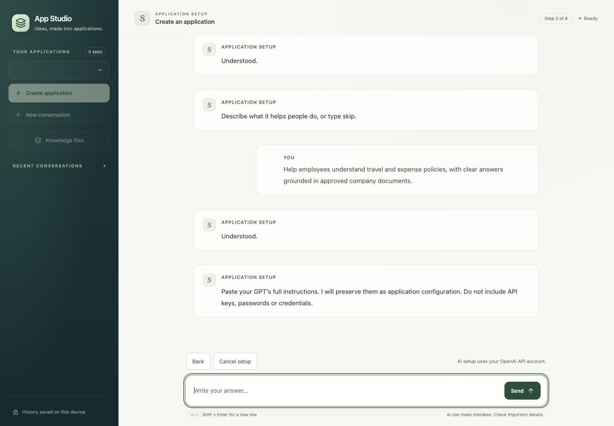
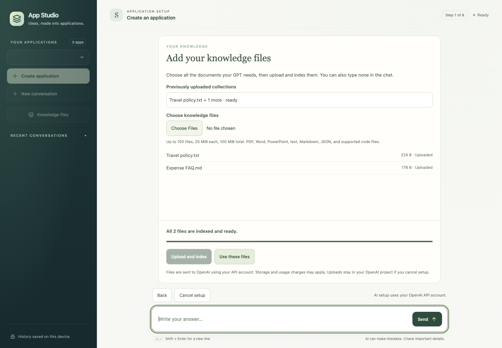
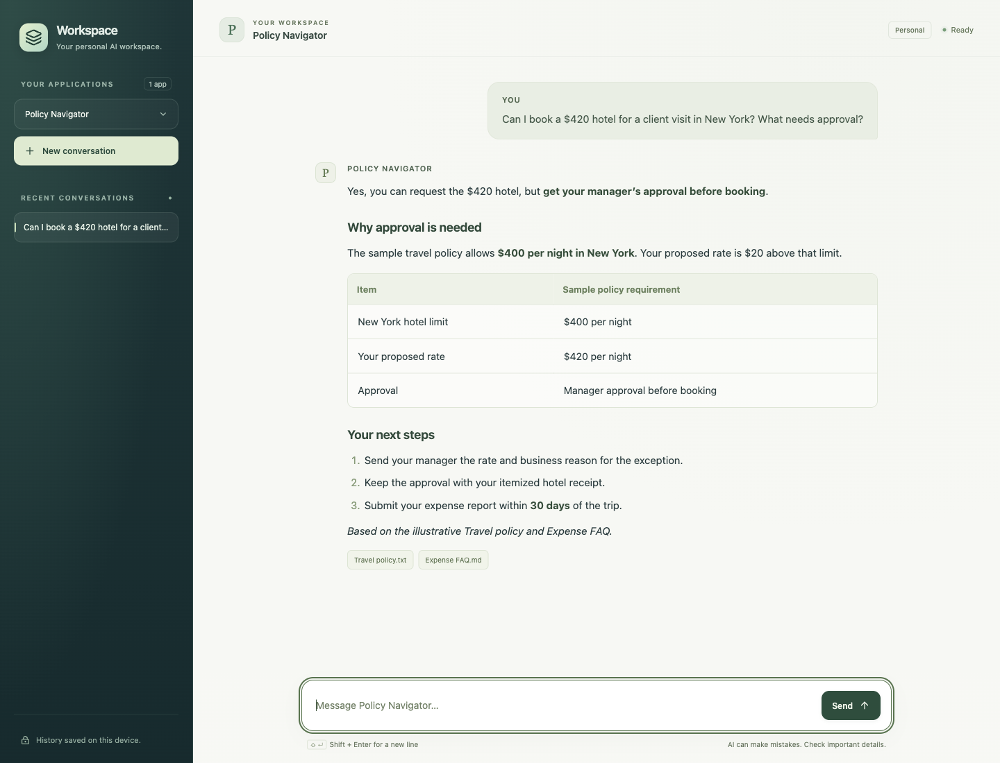

# From Custom GPT to Standalone AI App: Why I Built AI App Studio

Your team’s most useful Custom GPT may already be a business application in disguise.

It starts with someone solving a recurring problem. A colleague tries it. A team adopts it. Before long, a process depends on it.

Then someone asks: **“What happens if this stops working?”**

That question is the reason I created **AI App Studio**.

## What is a Custom GPT?

A Custom GPT is a version of ChatGPT configured for a particular purpose. It combines instructions, reference knowledge, and selected capabilities to create a tailored assistant inside ChatGPT.

A team might build one to explain company policies, support research, or guide an operational task. The appeal is straightforward: people who understand the work can shape an assistant around it.

For readers new to the concept, [OpenAI’s guide to GPTs](https://help.openai.com/en/articles/8554407-gpts-in-chatgpt) explains the building blocks.

## Custom GPT retirement creates a decision point

OpenAI is retiring Custom GPTs and providing a migration path to plugins. Its published guidance schedules standard retirement for **December 11, 2026**.

FedRAMP workspaces and affected Enterprise workspaces with a qualifying, approved deferral have a **February 11, 2027** retirement date. Follow the notice for your account or workspace, including any different timeline communicated to you. Migration availability also varies.

Plugins can bring reusable instructions, reference files, and connected apps together. They provide a way to continue workflows within ChatGPT. Migration still requires testing, and custom Actions need separate integration work.

See [OpenAI’s retirement FAQ](https://help.openai.com/en/articles/20001519-custom-gpt-retirement-and-migration-faq) and [plugin migration guide](https://learn.chatgpt.com/docs/migrate-custom-gpts) for the current guidance.

*Platform guidance checked November 8, 2026.*

## When an end-user assistant becomes a critical workload

I think of Custom GPTs—and plugins used this way—as **end-user assistants, or EUAs**. That is my framing for accessible tools that help people apply AI to their work.

An EUA can become valuable enough that its team starts treating it as infrastructure. People expect consistent answers, reliable access, and someone to call when something goes wrong.

At that point, I believe the workload deserves a deliberate application strategy. For some teams, a governed workflow inside ChatGPT will fit. For others, the requirements will justify a dedicated AI application with its own deployment and operating model.

The questions become practical:

- **Observability:** Can we trace a request and understand failures, latency, tool use, and cost?
- **Continuous evaluations:** Can we measure answer quality and detect regressions when instructions, models, or knowledge change?
- **Logging:** Can we investigate problems while protecting sensitive information and enforcing retention policies?
- **Security and access:** Can we control who can use the application and which information they can access?
- **Production support:** Who owns the service, responds to incidents, and manages recovery?
- **Release management:** Can we test a change, deploy it safely, and roll it back?

> When a workflow becomes critical, its operating model needs to grow with it.

A dedicated application gives you a place to implement these controls. Your team takes responsibility for building and operating them.

## Introducing AI App Studio

**AI App Studio is an experimental, MIT-licensed framework for creating standalone applications powered by OpenAI APIs—from Custom GPT configurations you own or from a fresh set of instructions.**

The idea is to carry forward the useful work: instructions, conversation starters, supported capabilities, and knowledge references. The resulting application provides a familiar chat interface and includes its own source code and launch scripts.

You can use guided, AI-assisted setup or import configuration in the framework’s supported JSON format. You review the configuration and its dependencies before creating the app.

## Create a new AI app from instructions, too

You can also start with a new idea and write the instructions directly in the studio. Those instructions define the assistant’s role, behavior, tone, and boundaries, creating a **Custom GPT–style chat experience in a standalone application**.

For example, you could create a meeting-preparation coach with instructions to ask about the audience and objective, suggest an agenda, and help the user anticipate questions.

Give the app a name, provide the instructions, choose its settings, and review the result. Knowledge files and integrations are optional. The application uses your configured OpenAI API access for live conversations.

The walkthrough below uses a policy assistant with knowledge files; the same setup flow can create an instructions-only assistant.

*The following screenshots show the actual framework and a generated application. They use synthetic company policies and simulated setup, knowledge, and chat providers. They illustrate the workflow and interface, rather than demonstrating live retrieval accuracy.*

## Step 1: Configure the application

For a migration, start with a GPT you own or are authorized to use. For a new app, define the behavior you want in your own instructions. Provide the app’s name, purpose, full instructions, conversation starters, model choice, and supported capabilities.

The setup conversation interprets ordinary-language answers and asks for clarification when needed. The full instructions are preserved as entered. You review the resulting configuration before creating the app.

In this example, I am creating **Policy Navigator**, an assistant for travel and expense questions.

*Figure 1. Guided setup turns owner-provided configuration into a reviewed application draft.*

## Step 2: Connect the knowledge files

If the GPT relies on documents, select multiple files, upload and index them, and wait until the collection is ready. Then choose **Use these files** to attach it to the application.

The framework uploads the selected documents to your OpenAI API project, creates a vector store, and checks indexing status before allowing the collection to be bound.

If the assistant does not need knowledge files, say so during setup.

*Figure 2. Two sample policy files are ready. Selecting “Use these files” binds the collection to the app.*

## Step 3: Generate and run the standalone app

After reviewing the configuration, download the standalone application and extract the complete ZIP.

The package includes the Python backend, application configuration, chat interface, README, and launch scripts for local Python and Docker. The generated app runs independently; the studio does not need to remain running.

The chat streams responses, renders Markdown, and saves conversations locally. For an app with knowledge bound, the runtime can use OpenAI’s hosted file search and display returned document citations.

*Figure 3. The generated standalone app displays a simulated answer with formatted text, a table, and document references.*

## Which OpenAI APIs are involved?

The framework separates setup and knowledge ingestion from the application’s runtime:

- **Responses API:** Interprets setup replies and powers the generated app’s conversations and supported tool use.
- **Files API:** Uploads the knowledge documents selected in the framework.
- **Vector Stores API:** Creates the knowledge collection, indexes uploaded files, and checks readiness before binding.

The generated app uses **file_search through Responses** to retrieve from a bound collection. It does not upload or re-index those documents at startup. Its API credentials must have access to the project that owns the collection.

The current implementation does not include the Agents API or Agents SDK. Custom Actions require reviewed backend adapters; their definitions do not automatically become executable integrations.

## A foundation to strengthen for production

AI App Studio is currently a **local, single-user prototype**. It provides configuration migration, compatibility checks, packaging, and a shared runtime.

Production observability, continuous evaluations, enterprise identity, tenant isolation, operational support, and reliability controls still need to be designed and implemented for the workload.

Behavioral parity with the original Custom GPT is also not guaranteed. Keep representative prompts and expected results, compare the replacement, and test retrieval, integrations, and difficult cases before relying on it.

## Explore the studio and help shape what comes next

I built AI App Studio to make the path from a useful assistant—or a new set of instructions—to a standalone application easier to explore, and to provide a reusable starting point for the engineering that follows.

For the architecture, API map, walkthrough, run instructions, and production considerations, visit the [AI App Studio companion page](https://ai-app-studio-introduction.peppyshrimp1.chatgpt.site).

To try the framework, inspect the code, or contribute, visit [AI App Studio on GitHub](https://github.com/skarlekar/ai-app-studio).

**What signals tell you an end-user assistant has become a critical workload in your organization?**

#AIAppStudio #EnterpriseAI #CustomGPT #AIEngineering #LLMOps #OpenSource
